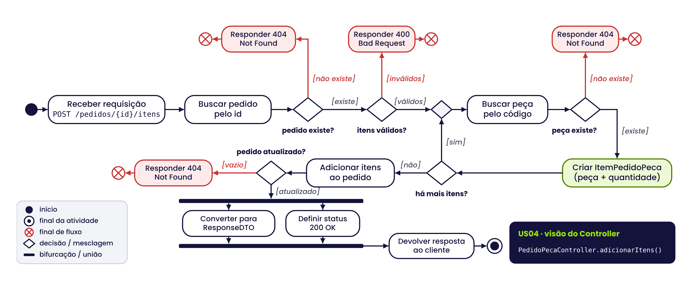

# Diagrama de Atividade – US04

**Versão oficial, criada em 27/09/2026 conforme o código presente no projeto.**

- **User Story:** US04 – Adicionar peças a um pedido existente
- **Endpoint:** `POST /api/pedidos/{id}/itens`
- **Visão:** Controller – `PedidoPecaController.adicionarItens()`

## Fluxo

1. O Controller recebe a requisição com a lista de itens (`AdicionarItensPedidoRequestDTO`).
2. Busca o pedido pelo id. Se não existir, responde **404 Not Found**.
3. Valida os itens: lista não vazia, código da peça informado e quantidade maior que zero. Se algum item for inválido, responde **400 Bad Request**.
4. Para cada item (laço iniciado por um nó de mesclagem):
   - busca a peça pelo código; se não existir, responde **404 Not Found**;
   - se existir, cria `ItemPedidoPeca(peca, quantidade)` (entidade associativa).
5. Adiciona os itens ao pedido (`PedidoPecaRepository.adicionarItens`). Se o retorno vier vazio, responde **404 Not Found**.
6. Bifurcação: converte o pedido em `PedidoPecaResponseDTO` e define o status **200 OK**, duas ações independentes que se juntam na união.
7. Devolve a resposta ao cliente e encerra a atividade.

## Nós de controle UML

| Nó | Onde aparece |
|---|---|
| Início | Entrada da requisição |
| Decisão | pedido existe?, itens válidos?, peça existe?, há mais itens?, pedido atualizado? |
| Mesclagem (merge) | Entrada do laço que percorre os itens |
| Bifurcação (fork) / União (join) | Montagem da resposta: DTO + status 200 |
| Final de fluxo | Encerra cada caminho de erro (400 / 404) |
| Final da atividade | Encerra o caminho de sucesso |
